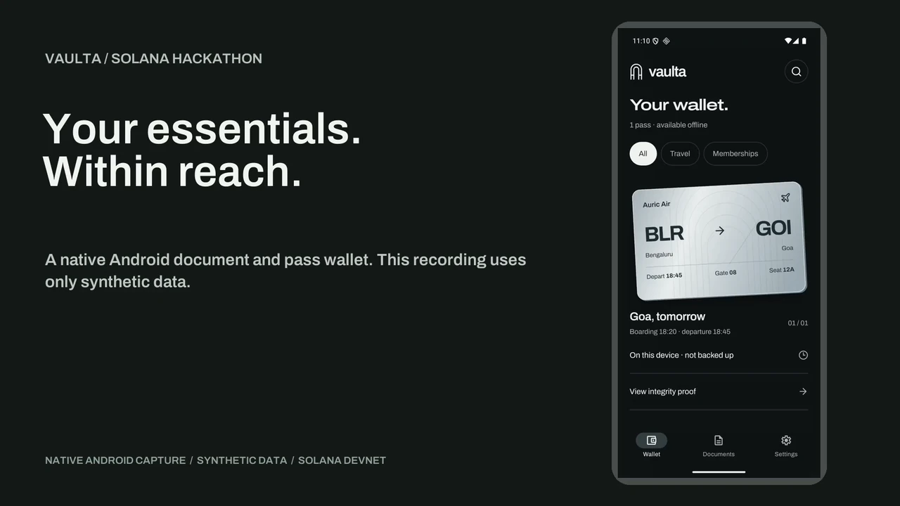
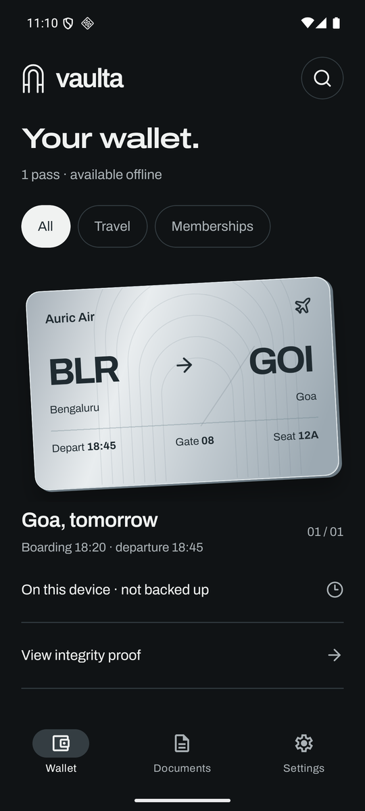
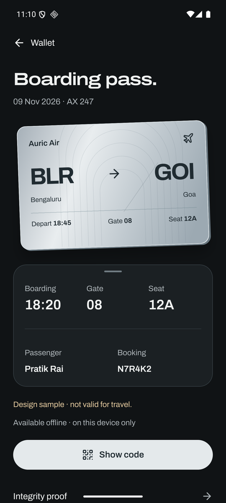
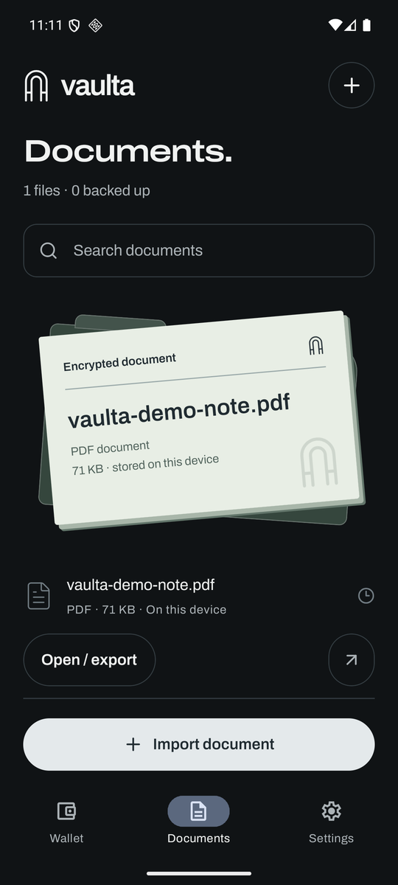
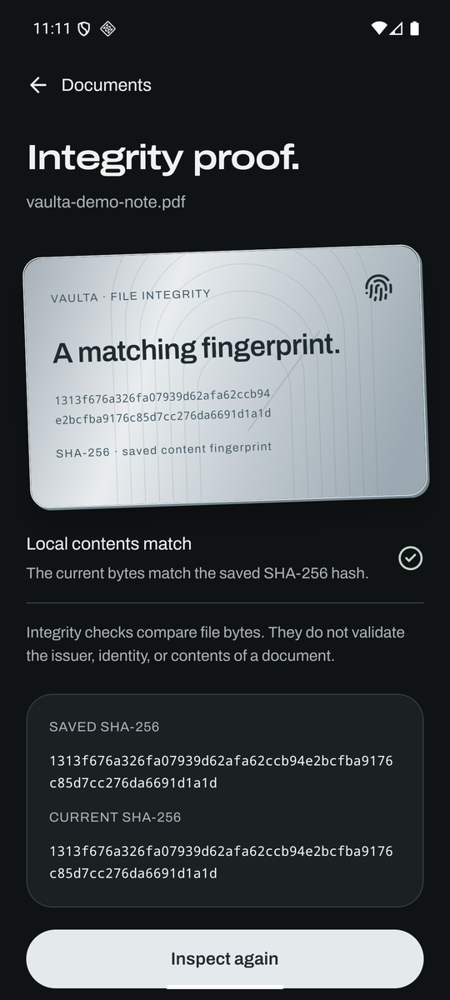

<div align="center">
  

  <h1>Vaulta</h1>

  <p><strong>Your essentials. Within reach.</strong></p>
  <p>
    A native Android wallet for your passes and documents.<br />
    Encrypted on your phone, with Solana-owned recovery and Arweave backups.
  </p>

  <p>
    <a href="#install">Install</a> ·
    <a href="#see-it-in-use">Demo</a> ·
    <a href="#architecture">Architecture</a> ·
    <a href="docs/validation.md">Validation</a> ·
    <a href="https://github.com/PratikRai0101/vaulta/issues">Issues</a>
  </p>

  <p>
    <a href="#install"></a>
    <a href="#tech-stack"></a>
    <a href="#tech-stack"></a>
    <a href="#why-solana"></a>
    <a href="#project-status"></a>
  </p>
</div>

> [!IMPORTANT]
> **Vaulta is an experimental hackathon build. Use synthetic documents only.** Local encrypted storage and file-integrity checks were exercised on an Android emulator. Funded on-chain backup confirmation and clean-install remote recovery remain unverified. This is not audited storage for personal IDs. Read the [storage and recovery limits](docs/storage-and-recovery.md).

## See it in use

<p align="center">
  <a href="https://youtu.be/2vnOURbt3Cs">
    
  </a>
  <br />
  <a href="https://youtu.be/2vnOURbt3Cs"><strong>Watch the 92-second demo</strong></a> ·
  <a href="https://github.com/PratikRai0101/vaulta/releases/download/v0.1.0-hackathon/vaulta-demo.mp4">Download the MP4</a>
  <br />
  <sub>Recorded for the Solana Hackathon 2026. Native Android emulator footage, synthetic documents, narrated walkthrough.</sub>
</p>

The demo opens a saved boarding pass, presents its sample QR code, inspects the stored file bytes, and checks an imported PDF. Settings and recovery show the implemented network paths without claiming a completed backup or remote restore.

## Screens

<table>
  <tr>
    <td align="center" width="50%">
      
      <br /><strong>Wallet</strong><br /><sub>Passes available on this device, with backup state visible.</sub>
    </td>
    <td align="center" width="50%">
      
      <br /><strong>Boarding pass</strong><br /><sub>Travel details and a sample code in one place.</sub>
    </td>
  </tr>
  <tr>
    <td align="center" width="50%">
      
      <br /><strong>Documents</strong><br /><sub>Imported originals stored in the encrypted vault.</sub>
    </td>
    <td align="center" width="50%">
      
      <br /><strong>Integrity proof</strong><br /><sub>Current file bytes compared with the saved fingerprint.</sub>
    </td>
  </tr>
</table>

Every screenshot is a capture of the installed native app on an Android API 36 emulator. These are not browser mockups or physical-device test results. Sample passes are not valid for travel.

## What it does

- Keep travel passes and self-created memberships in a native wallet interface.
- Import original documents with Android's file picker, then open or export them through native apps.
- Present sample QR codes without claiming NFC, payments, or issuer verification.
- Encrypt file contents and the local index with XChaCha20-Poly1305.
- Read stored file bytes and compare their SHA-256 fingerprints with the saved values.
- Connect an external wallet through Mobile Wallet Adapter without collecting seed phrases.
- Upload encrypted files and a manifest through Turbo, then record an owner-signed recovery pointer on Solana devnet.
- Discover wallet-owned recovery records or import a public recovery receipt. These network paths are implemented, not certified end to end.

Vaulta has no application account, password database, or account-recovery server. The current build supports up to 100 items and limits each encrypted upload to less than 2 MiB.

## Why Solana?

Solana is the ownership and discovery layer. An owner-signed Memo record binds an encrypted manifest ID and ciphertext digest to the wallet that authorized the backup. The client verifies the signature and transaction success, rejecting records that merely mention the address. The app uses the standard Memo program, not a custom deployed smart contract.

A separate, fixed wallet message derives the encryption key through a verified signature and HKDF-SHA256. That signature is private key material. Vaulta never publishes it or reuses it for uploads. Recovery depends on the same account reproducing the same signature bytes, which adds phishing and cross-wallet compatibility risks.

Arweave stores the encrypted files and manifest. Solana does not store PDFs, filenames, or the private recovery signature. A matching content hash proves byte integrity, not identity or document authenticity.

Read [how storage and recovery work](docs/storage-and-recovery.md) for the protocol, permanent-storage warning, and failure cases.

## Install

**[Download the Android APK](https://github.com/PratikRai0101/vaulta/releases/download/v0.1.0-hackathon/vaulta.apk)** from the [hackathon release](https://github.com/PratikRai0101/vaulta/releases/tag/v0.1.0-hackathon).

The standalone ARM64 APK runs on Android 7 or later without Metro. It uses a local development signing certificate, not a production distribution key. There is no Play Store or tested iOS release.

1. Install the APK and a Mobile Wallet Adapter-compatible wallet.
2. Connect the wallet and approve the two private recovery-message signatures. Keep using the same account for this vault.
3. Add a sample pass or import a synthetic document under 2 MiB.
4. Open **Integrity proof**, then select **Inspect file** to compare its current bytes with the saved fingerprint.

To browse without connecting a wallet, choose **Try design preview**. Preview uses samples and does not save personal files or claim successful uploads.

<details>
<summary><strong>Try the experimental backup and recovery paths</strong></summary>

On-chain backup confirmation and clean-install remote recovery remain unverified. Use synthetic files and keep the original device data until you have an independently usable backup.

### Back up a vault

1. Keep some devnet SOL in the connected account. Use the [official Solana faucet](https://faucet.solana.com) if the RPC faucet rejects requests.
2. Open **Settings**, then select **Back up vault**.
3. Read the permanent-storage warning before approving uploads and the devnet transaction.
4. Export the public recovery receipt after a confirmed backup.

Turbo acceptance is not immediate Arweave settlement. An uploaded file without a confirmed recovery record stays pending. Larger uploads can require Turbo credits. The app has no paid top-up interface or unlimited-free-storage promise.

### Recover on another phone

1. Connect the same wallet account and approve the unchanged Vaulta v1 recovery message.
2. Open **Settings**, then select **Restore on this phone**.
3. Select **Discover & restore backup** to find an owner-signed record in Solana devnet history.
4. If history is missing, select **Import recovery receipt** and choose your exported JSON receipt.

A receipt contains a locator, not a decryption key. Receipt imports authenticate downloaded content with the wallet-derived key. They do not prove that the old transaction is still confirmed or that the snapshot is the latest one. Devnet history can reset.

</details>

## Build from source

Use Node 22.13 or later within the Expo SDK 58 supported range, JDK 21, and an Android SDK.

```sh
git clone https://github.com/PratikRai0101/vaulta.git
cd vaulta/mobile
npm ci
npm run typecheck
npm run lint
npm test
npm run build:android
```

The build script produces `mobile/builds/vaulta.apk` relative to the repository root. Set `ANDROID_HOME` and `JAVA_HOME` if the script cannot find the SDK or JDK. Run `npm run android` from `mobile/` for a development build.

## Tech stack

| Layer | Technology |
| --- | --- |
| App | React Native 0.88, React 19, Expo SDK 58, TypeScript 6 |
| Navigation and motion | Expo Router, React Native Gesture Handler, Reanimated |
| Wallet and journal | Solana Mobile Wallet Adapter, `@solana/web3.js`, standard Memo program on devnet |
| Local encryption | XChaCha20-Poly1305, HKDF-SHA256, Ed25519 verification through Noble libraries |
| Local storage | Expo FileSystem, two encrypted JSON index generations, optional biometric-protected SecureStore key cache |
| Remote storage | Arweave through Turbo, signed Solana ANS-104 data items |
| Documents and codes | Expo DocumentPicker, native file sharing, React Native SVG and QR rendering |
| Validation | Zod, Node tests, TypeScript, type-aware ESLint, native Android checks |

The app calls no runtime AI APIs or models. Development used the Pi coding-agent harness with GPT-6.1-Sol.

## Architecture

The UI runs as a native React Native application, not a website inside a WebView. A single vault controller coordinates local state, wallet approvals, file operations, and network work.

| Path | Responsibility |
| --- | --- |
| `mobile/src/app/` | Wallet, documents, settings, pass, proof, add, and restore routes |
| `mobile/src/core/controller.ts` | Vault operations and state transitions |
| `mobile/src/core/crypto.ts` | Authenticated encryption and recovery-key derivation |
| `mobile/src/core/storage.ts` | Encrypted files, index generations, key cache, temporary plaintext cleanup |
| `mobile/src/core/wallet.ts` | Wallet authorization, signing, Memo publication, recovery discovery |
| `mobile/src/core/remote.ts` | Bounded uploads, downloads, and ciphertext-hash validation |
| `mobile/src/core/dataItem.ts` | Signed ANS-104 data items for Turbo |
| `mobile/src/ui/` | Native pass artwork and shared controls |

Opening or exporting a document creates a temporary plaintext copy. Vaulta cleans its own temporary copies on lock and startup, but cannot remove copies kept by another app. Screenshot blocking is not implemented.

## Project status

Submitted to the **Solana Hackathon 2026**, in **Top 3 Overall**. This is a prototype submission, not a prize or production-security claim.

Locally verified:

- TypeScript, type-aware ESLint, and seven Node tests.
- Native APK installation and launch on an Android API 36 emulator.
- Mobile Wallet Adapter authorization and two verified repeatable signatures with Solana Mobile's development reference wallet.
- Encrypted native sample storage, PDF import, and inspection of actual file bytes.
- A separate tiny synthetic Turbo upload and download with a matching ciphertext digest.

Still unverified:

- Funded on-chain backup confirmation and clean-install remote recovery.
- Physical-device biometrics, Solflare, Seed Vault, and cross-wallet recovery compatibility.
- iOS builds and production signing.

NFC, payments, issuer verification, camera scanning, an incoming share extension, and paid Turbo top-ups are not implemented. GitHub Actions has not completed a successful run. Local checks are not a CI-pass claim.

See the [validation report](docs/validation.md) for evidence and reproduction limits.

## Reproduce checks

Run these commands from `mobile/`:

```sh
npm run typecheck
npm run lint
npm test
npm run verify:android
```

The Android runner refuses interactions outside `com.vaulta.wallet`. The preview check does not certify wallet or storage-network operations.

The optional network smoke test creates tiny permanent synthetic uploads and attempts devnet transactions. Run it only when you intend those network writes:

```sh
npm run test:network -- --live
```

## Documentation

| Document | Contents |
| --- | --- |
| [Storage and recovery](docs/storage-and-recovery.md) | Encryption, wallet ownership, permanent storage, recovery, and security limits |
| [Validation report](docs/validation.md) | What ran, what passed, and what remains unverified |
| [Network contract](mobile/NETWORK_CONTRACT.md) | Wallet, upload, and recovery protocol requirements |
| [Implementation plan](IMPLEMENTATION.md) | Native implementation scope and decisions |

Archivo is bundled under the [SIL Open Font License](mobile/assets/fonts/OFL.txt). Vaulta's arch artwork is original to this project.
